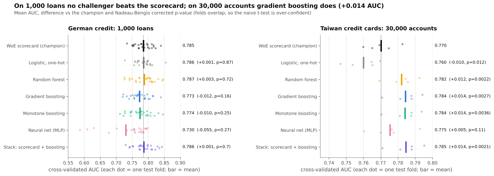
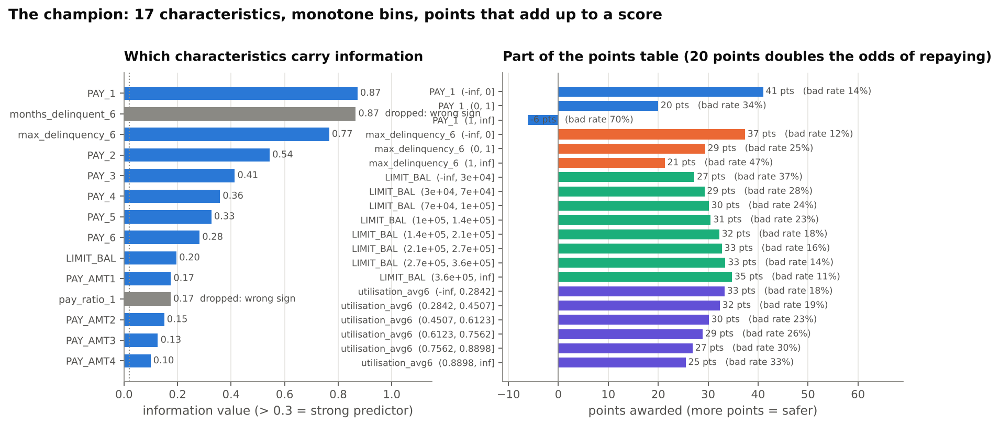
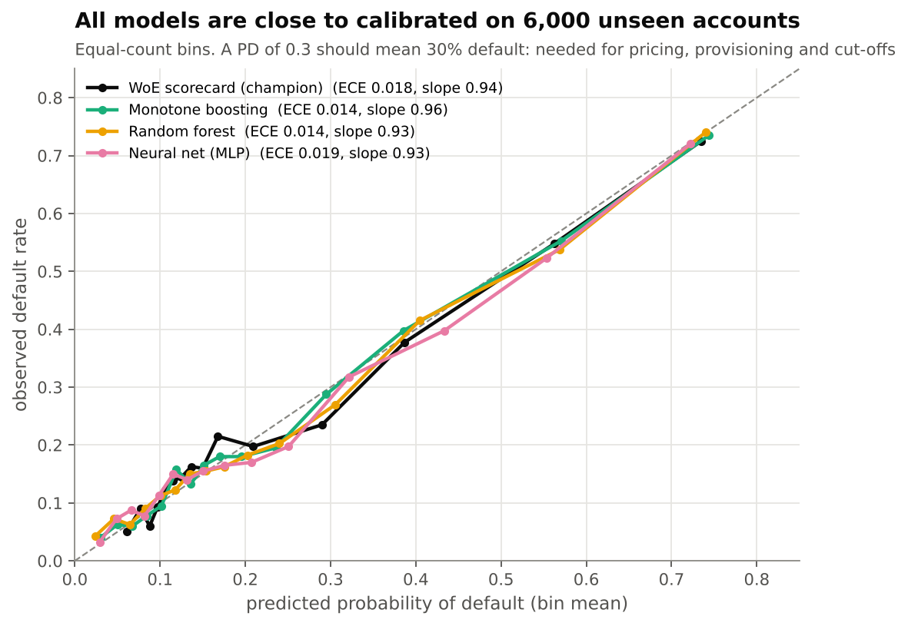
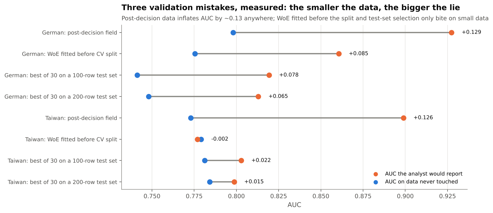
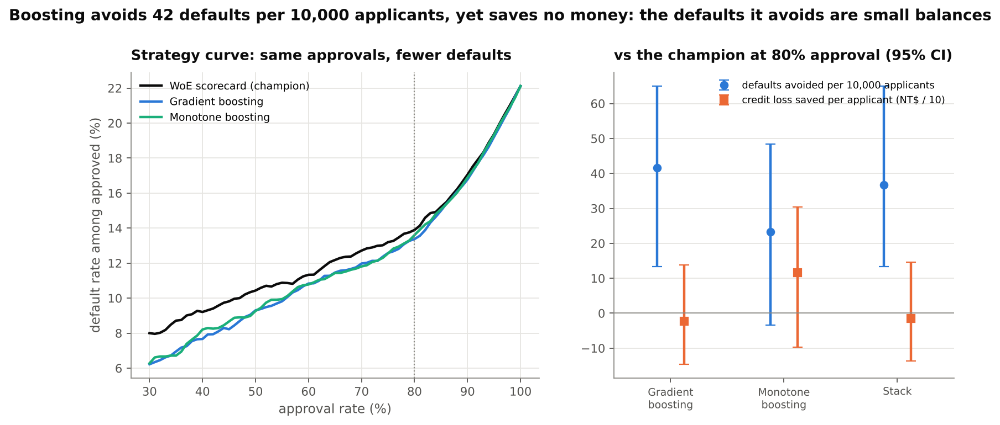
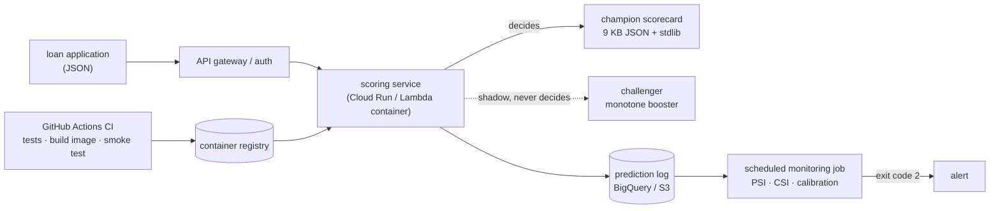
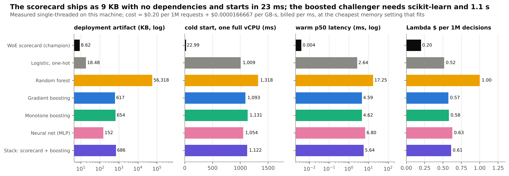
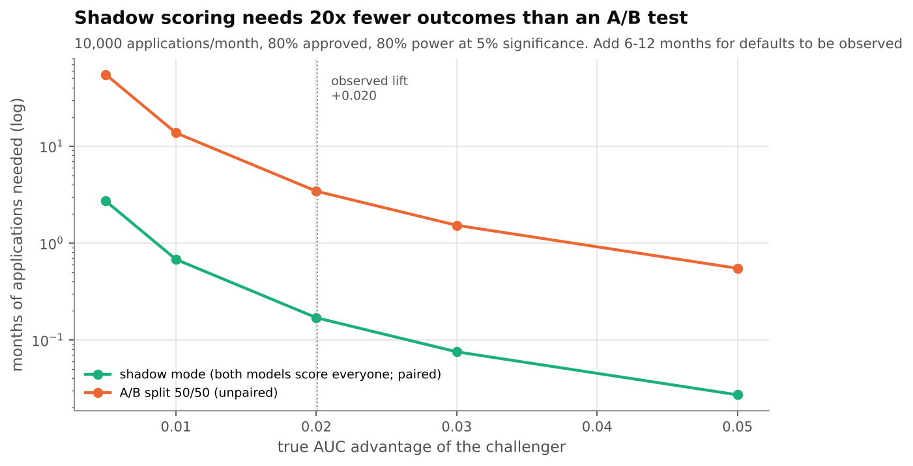
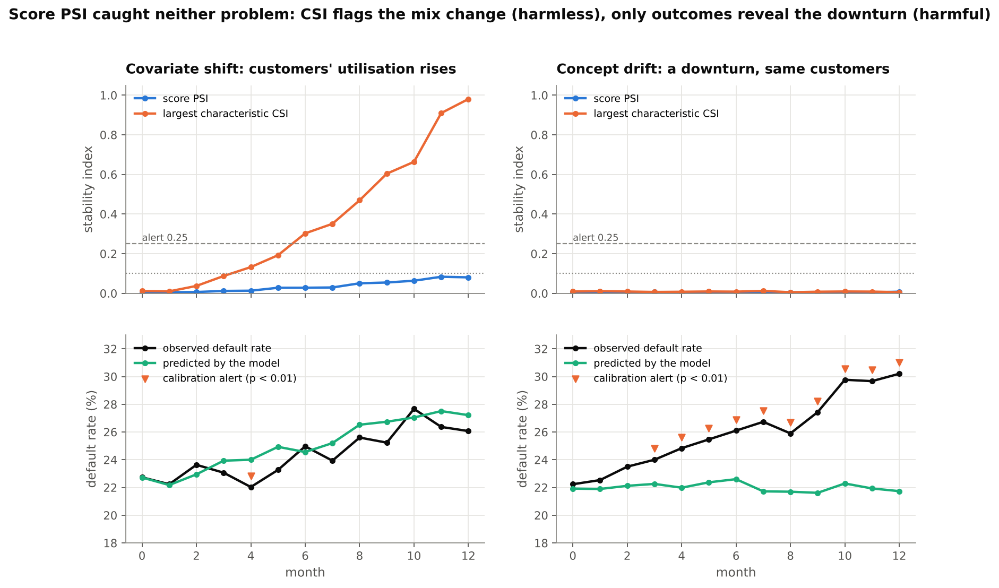

# Credit Risk: Champion Scorecard vs Machine-Learning Challengers, Deployed as a Cloud Service

This project covers the whole life of a credit-scoring model, the way banks actually run it:

1. **Build the champion.** A points-based **weight-of-evidence (WoE) scorecard**, the industry standard because every point can be explained to a customer and to a regulator.
2. **Benchmark six challengers.** Gradient boosting (the LightGBM algorithm), a monotone-constrained booster, random forest, neural network, logistic regression and a stacked ensemble, on two datasets of very different size, with proper significance tests.
3. **Audit the validation.** Measure how much three common mistakes (leakage) inflate the reported accuracy.
4. **Turn AUC into decisions and money.** Strategy curves, credit losses, the dataset's cost matrix and a fairness check.
5. **Put it in the cloud.**
   - A REST scoring API that returns adverse-action reason codes. The champion decides; the challenger runs in **shadow mode**.
   - A Dockerfile and CI.
   - Measured **cold-start, latency, memory and serverless cost** per model.
   - The statistics of how long a live challenger test must run.
   - **Drift monitoring** as a scheduled job.

<p align="center"></p>

## Key findings

| Question | Answer |
|---|---|
| Does machine learning beat the scorecard? | **It depends on the data size.** On 1,000 German loans, no challenger is significantly better (best: +0.003 AUC, p = 0.72). On 30,000 Taiwanese card accounts, gradient boosting wins by **+0.014 AUC** in cross-validation (p = 0.003) and +0.022 on the hold-out (DeLong p < 10⁻⁸). |
| What does a regulator-friendly booster cost in accuracy? | Almost nothing. Forcing risk to be monotone in delinquency, limit, utilisation and payments costs **0.0003 AUC**. |
| How much do validation mistakes inflate results? | A post-decision field adds **+0.13 AUC** on both datasets. Fitting WoE before the CV split adds **+0.085** on German data and nothing on Taiwan. Picking the best of 30 models on a 100-row test set adds **+0.078** on German data. |
| Is a higher AUC worth money? | Not automatically. Boosting approves **42 fewer defaulters per 10,000 applicants** (95% CI 13–65), yet saves **no credit loss** (CI −146 to +139 NT$ per applicant): the defaults it avoids are small balances. |
| What does each model cost in the cloud? | The scorecard is **9 KB** (a JSON points table plus a standard-library scorer): it starts in 23 ms, takes 4 µs per decision and costs **$0.20 per million** decisions. The booster needs scikit-learn: 1.1 s cold start, 154 MB of memory, **$0.58 per million**. Even so, the challenger's extra compute per decision is about **3 billion times smaller** than the loss from one default. |
| How long must a challenger run live? | In shadow mode, **1,344 matured outcomes** are enough to confirm the lift. A 50/50 A/B test needs **27,181**, 20 times as many. Both must then wait 6–12 months for defaults to show up. |
| Does PSI monitoring catch problems? | **Score PSI caught neither simulated problem.** Characteristic CSI flags a harmless change in the customer mix. Only outcome monitoring catches a downturn, and it raises the alarm 3 months in. |

---

## Contents

1. [The data](#1-the-data)
2. [The champion: a WoE points scorecard](#2-the-champion-a-woe-points-scorecard)
3. [The challengers and how they are compared](#3-the-challengers-and-how-they-are-compared)
4. [Leakage audit](#4-leakage-audit-what-validation-mistakes-cost)
5. [From AUC to decisions and money](#5-from-auc-to-decisions-and-money)
6. [The cloud side](#6-the-cloud-side)
7. [Monitoring in production](#7-monitoring-in-production)
8. [Run it](#run-it) · [Limitations](#limitations) · [Questions to be ready for](#questions-to-be-ready-for) · [Structure](#project-structure) · [References](#references)

---

## 1. The data

| | German credit | Taiwan credit cards |
|---|---|---|
| Rows | 1,000 instalment loans | 30,000 card holders |
| Bad rate | 30% | 22.1% (default in October 2005) |
| Characteristics | 19: account status, history, purpose, amount, savings, employment, age… | 27: limit, 6 months of repayment status, bills and payments, plus 5 engineered ones (utilisation, payment ratio, months delinquent, worst delinquency) |
| Role | small-data case, like a new product or a niche portfolio | large-data case, like a mature card book |

**Protected attributes (sex) are not model inputs.** They are kept aside only to check approval rates afterwards. Details and sources are in [data/README.md](data/README.md).

## 2. The champion: a WoE points scorecard

<p align="center"></p>

**Binning.** [`binning.py`](src/creditrisk/binning.py) splits each numeric characteristic into up to 10 quantile bins. It then merges neighbouring bins until two conditions hold:

- every bin holds at least 5% of applicants;
- the bad rate is **monotone** (for example, more past delinquency never earns more points).

Rare categories are pooled with the category whose bad rate is closest.

**Weight of evidence.** Each bin b gets

$$\text{WoE}_b = \ln\frac{\text{good}_b / \text{good}_{total}}{\text{bad}_b / \text{bad}_{total}}, \qquad \text{IV} = \sum_b \left(\frac{\text{good}_b}{\text{good}_{total}} - \frac{\text{bad}_b}{\text{bad}_{total}}\right)\text{WoE}_b$$

- WoE > 0 means safer than average.
- The **information value** (IV) ranks characteristics. A rule of thumb: < 0.02 useless, > 0.3 strong.
- Characteristics with IV < 0.02 are dropped.

**Model.** [`scorecard.py`](src/creditrisk/scorecard.py) fits an L2-regularised logistic regression on the WoE values, with C chosen by 5-fold CV on log-loss.

**Sign check.** With "positive WoE = safer", every coefficient on P(bad) must be negative. A positive one means **collinearity** is distorting the model, so the weakest offender is dropped and the model is refitted. On Taiwan, `months_delinquent_6` and `pay_ratio_1` were dropped this way: they duplicate information in `PAY_1…6`.

**Points.** Following the industry convention, the score is

$$\text{score} = \text{offset} + \text{factor}\cdot\ln(\text{odds of good}), \qquad \text{factor} = \frac{\text{PDO}}{\ln 2} = 28.85$$

- 600 points corresponds to odds of 50:1.
- Every **20 points doubles the odds** of repaying (PDO = 20).
- Each characteristic contributes points. The points add up to the score, and the score maps back to a PD.

**Reason codes.** For a declined applicant, the API reports the characteristics where they lost the most points, compared with the best attribute of each. Lenders must give such reasons, for example under US ECOA / Regulation B adverse-action notices.

**Portable runtime.** The fitted scorecard exports to a JSON points table plus a standard-library scorer ([`runtime.py`](src/creditrisk/runtime.py)). A test checks that the scorer reproduces the scikit-learn model's scores exactly.

## 3. The challengers and how they are compared

| Model | Why it is in the line-up |
|---|---|
| Logistic regression on one-hot features | the old baseline: linear, but without binning |
| Random forest | bagged deep trees; low bias, needs data |
| **Gradient boosting** (`HistGradientBoostingClassifier`) | the LightGBM algorithm: histogram splits, early stopping; hyper-parameters tuned by randomised CV inside each training fold |
| **Monotone gradient boosting** | the same booster, constrained so that risk can only rise with delinquency and utilisation and only fall with limit and payments. This keeps the explainability argument regulators ask for |
| Neural network (MLP, 64-32) | quantile-normalised inputs, early stopping |
| Stack | a logistic meta-model on out-of-fold PDs of the scorecard and the booster |

**Protocol.**

- **German:** 5-fold CV repeated 5 times (25 folds).
- **Taiwan:** 5-fold CV, plus a fixed 80/20 hold-out (6,000 accounts) that every later experiment uses.
- **No leakage from tuning:** every model is refitted and tuned **inside** each training fold.

**Significance tests.**

- **Between CV folds:** the Nadeau–Bengio *corrected resampled t-test*. CV training sets overlap, so the folds are not independent and the naive t-test is too confident. The correction inflates the variance by (1/k + n_test/n_train).
- **On the hold-out:** the **DeLong test**, which handles two correlated AUCs measured on the same applicants.

**German, 1,000 loans (25 CV folds)**

| Model | AUC | vs champion | p |
|---|---|---|---|
| **WoE scorecard** | **0.785** | | |
| Logistic | 0.786 | +0.001 | 0.87 |
| Random forest | 0.787 | +0.003 | 0.72 |
| Gradient boosting | 0.773 | −0.012 | 0.16 |
| Monotone boosting | 0.774 | −0.010 | 0.25 |
| Neural net | 0.730 | −0.055 | 0.27 |
| Stack | 0.786 | +0.001 | 0.70 |

**Taiwan, 30,000 accounts**

| Model | CV AUC | vs champion | corrected p | Hold-out AUC [95% CI] | KS | Calibration error (ECE) |
|---|---|---|---|---|---|---|
| **WoE scorecard** | **0.770** | | | 0.759 [0.744, 0.773] | 0.393 | 0.018 |
| Logistic | 0.760 | −0.010 | 0.012 | 0.748 | 0.394 | 0.011 |
| Random forest | 0.782 | +0.012 | 0.002 | 0.774 | 0.421 | 0.014 |
| Gradient boosting | 0.784 | +0.014 | 0.003 | **0.781** [0.767, 0.795] | 0.424 | 0.015 |
| Monotone boosting | 0.784 | +0.014 | 0.004 | 0.779 [0.765, 0.793] | 0.425 | 0.014 |
| Neural net | 0.775 | +0.005 | 0.11 | 0.770 | 0.416 | 0.019 |
| Stack | 0.785 | +0.014 | 0.002 | 0.781 | 0.420 | 0.026 |

**What this shows:**

- **Model complexity has to be paid for with data.**
  - On 1,000 rows the flexible models cannot beat binned logistic regression, and they are much less stable. The neural net's fold AUCs range from 0.43 to 0.80.
  - On 30,000 rows, the interactions the boosters find, for example between recent delinquency and utilisation, are real and measurable.
  - This reverses the earlier version of this project (logistic regression beat XGBoost on the German data), and explains why.
- **Monotone constraints are almost free.** The constrained booster matches the unconstrained one to within 0.0003 AUC in CV. It also guarantees, for example, that an extra month of delinquency can never *raise* a score, which is what makes a booster explainable to a model-risk committee.
- **The scorecard's binning helps on small data and hurts on large data.**
  - On Taiwan, the scorecard beats plain one-hot logistic regression (+0.010), because bins capture non-linearity.
  - It loses to the trees, because each bin is a step function with no interactions.
- **Random forest memorises.** Its training AUC is 0.934 against a test AUC of 0.774. Its score is still good, but its probabilities need checking.

<p align="center"></p>

**Calibration matters as much as AUC.** A PD feeds pricing, IFRS 9 / CECL provisions and the approval cut-off, so a PD of 0.3 should mean 30% default.

- **Taiwan:** all models are within about 2 percentage points (ECE 0.011–0.026). Calibration slopes of 0.93–0.99 mean the predictions are very slightly too extreme.
- **German:** see the cost-matrix result in section 5, where miscalibration directly costs money.

## 4. Leakage audit: what validation mistakes cost

<p align="center"></p>

[`leakage_audit.py`](experiments/leakage_audit.py) builds each mistake on purpose. For each one it compares the AUC an analyst would **report** with the AUC on 30% of the data that was never touched:

| Mistake | German: reported → real | Taiwan: reported → real |
|---|---|---|
| **A. Post-decision field.** A simulated "sent to collections" flag, recorded after the outcome. At decision time it does not exist yet. | 0.927 → 0.798 | 0.899 → 0.773 |
| **B. WoE fitted on all rows before cross-validation.** Fine bins (up to 40); the target leaks into the encoding. | 0.861 → 0.775 | 0.777 → 0.779 |
| **C. Best of 30 models picked on the test set.** The winner's curse: the maximum of 30 noisy estimates is biased upwards. | 0.819 → 0.741 (100-row test) | 0.803 → 0.781 (100-row test); no bias at 1,000+ rows |

**What this shows:**

- **Post-decision data is catastrophic at any size.** It adds about +0.13 AUC on both datasets.
- **The other two mistakes scale with (number of choices) / (number of rows).** Target-encoding leakage is roughly the number of bins divided by the number of rows. Selection bias is the spread of the maximum of 30 estimates, each with a standard error of about 1/√n_test. On 30,000 rows both disappear; on 1,000 rows they are as large as the whole difference between models.
- **This is why section 3 uses nested tuning and corrected tests.**

## 5. From AUC to decisions and money

<p align="center"></p>

**Strategy curve (Taiwan).** At any approval rate, the boosters approve fewer eventual defaulters. Compared at an 80% approval rate on the 6,000 hold-out accounts:

| Challenger vs scorecard | Defaults avoided per 10,000 applicants | Credit loss saved per applicant (NT$) |
|---|---|---|
| Gradient boosting | **42** [13, 65] | −23 [−146, +139] |
| Monotone boosting | 23 [−3, 48] | +116 [−97, +304] |
| Stack | 37 [13, 65] | −15 [−137, +146] |

Loss is calculated as EAD × LGD for each approved defaulter, with EAD = the September balance and LGD = 75% (an assumption, typical for unsecured cards). The intervals are paired bootstrap 95% CIs.

**Fewer defaults ≠ lower losses.**

- A PD model ranks applicants by *probability*, not by *exposure*.
- The extra defaulters the booster rejects tend to have small balances.
- Expected loss is PD × EAD × LGD, so a lender optimising money should rank on expected loss (or price for it), not on PD alone.
- An AUC lift is a necessary condition for business value, not a proof of it.

**Cost matrix (German).** The dataset's documentation says approving a bad applicant costs 5 times as much as rejecting a good one.

- **Decision rule:** the Bayes-optimal cut-off is to reject when PD > 1/(1+5) = 0.167, **but only if the PDs are calibrated**.
- **Benchmarks:** rejecting everyone costs 0.70 per applicant; accepting everyone costs 1.50.
- **Results at the 0.167 cut-off:**
  - Monotone boosting: 0.505
  - Scorecard: 0.570
  - One-hot logistic: 0.595

  The one-hot logistic model's best possible cut-off, chosen in hindsight, would have cost 0.455. Miscalibration (ECE 0.086) wastes that advantage. **Calibration converts directly into money.**

**Fairness check.** Sex is not a model input. Even so, approval rates by sex at the 80% cut-off are 81.0% (female) and 78.5% (male), giving an adverse impact ratio of **0.97** for the scorecard and 0.967–0.973 for every model. That is comfortably above the "four-fifths" (0.8) screening threshold. Proxies for a protected attribute can still enter through other inputs, which is why this check belongs in production monitoring too.

## 6. The cloud side



### 6.1 The scoring service

[`service/app.py`](service/app.py) is a Flask API.

- **Input:** applicant data validated with pydantic.
- **Features:** the derived characteristics are computed exactly as in training.
- **Decision:** the **champion makes the decision.**
- **Shadow challenger:** it is lazy-loaded so it never slows the champion's cold start, and any failure is caught so it can never affect a decision.
- **Logging:** every decision goes to the prediction log, tagged with a model version (the SHA-256 of the points table).

A real response for two applicants:

```json
{"results": [
  {"decision": "approve", "pd": 0.106701, "score": 548.4, "reason_codes": [],
   "model_version": "scorecard-2c204a9132c2", "shadow": {"model": "gbm_monotone", "pd": 0.121844}},
  {"decision": "decline", "pd": 0.591811, "score": 476.4,
   "reason_codes": [{"characteristic": "PAY_1", "attribute": "(1, inf]", "points_lost": 47.2},
                    {"characteristic": "max_delinquency_6", "attribute": "(1, inf]", "points_lost": 16.1},
                    {"characteristic": "PAY_AMT2", "attribute": "(-inf, 0]", "points_lost": 8.8},
                    {"characteristic": "PAY_AMT1", "attribute": "(-inf, 0]", "points_lost": 8.1}],
   "model_version": "scorecard-2c204a9132c2", "shadow": {"model": "gbm_monotone", "pd": 0.586506}}]}
```

The second applicant is declined mainly because they are 2+ months late this month (`PAY_1`). That is a reason a customer can understand and act on.

The [`Dockerfile`](service/Dockerfile) builds a slim, non-root gunicorn image. [`ci.yml`](.github/workflows/ci.yml) runs the unit and API tests and a reduced benchmark, then builds the image, starts it and scores an applicant through HTTP. [`DEPLOY.md`](service/DEPLOY.md) has the Cloud Run and Lambda commands. The service is deploy-ready but is not deployed from this repository.

### 6.2 What each model costs to serve

<p align="center"></p>

[`cloud_benchmark.py`](experiments/cloud_benchmark.py) measures every model single-threaded, because a Lambda function at ≤ 1,769 MB has at most one vCPU. It then prices the result on AWS Lambda's published rates:

- $0.20 per million requests + $0.0000166667 per GB-second, billed per ms;
- the INIT (cold-start) phase has been billed since August 2025;
- CPU scales with memory, so a 256 MB function runs at about 1/7 of a vCPU.

| | Scorecard (champion) | Monotone booster (challenger) | Random forest |
|---|---|---|---|
| Deployment artifact | 7 KB JSON + 2 KB code | 654 KB pickle + scikit-learn | 56 MB |
| Dependencies | Python standard library | numpy, scipy, pandas, scikit-learn | same |
| Cold start (one full vCPU) | 23 ms (bare Python: 18 ms) | 1.13 s | 1.32 s |
| Cold start at the chosen Lambda size | 16 ms at 128 MB | 5.9 s at 256 MB | 3.6 s at 512 MB |
| Peak memory | 13 MB | 154 MB | 264 MB |
| Warm latency p50 / p99 | 0.004 / 0.010 ms | 4.6 / 6.1 ms | 17 / 24 ms |
| **Cost per million decisions** | **$0.20** (almost all of it the request fee) | **$0.58** | $1.00 |

**Engineering consequences:**

- **The scorecard can run anywhere.** It fits in a 128 MB function, an edge worker, a SQL `CASE` statement or a mainframe batch job.
- **The challenger's cold start matters for latency, not money.** A 6-second cold start on an interactive loan application is the real cost. The remedies are a minimum instance count (paying for idle time), more memory (more CPU), or running the challenger **asynchronously** off the request stream. That is exactly what shadow mode allows.
- **Compute cost is negligible against credit risk.** The challenger costs $0.38 more per million decisions, while one average default costs NT$34,885 (about $1,090). The booster pays for its compute if it prevents one default every ~3 billion decisions. The real costs of a complex model are governance, explainability, validation and latency, not cloud bills.

### 6.3 How long must a challenger run live before you can trust it?

<p align="center"></p>

**The problem.** A challenger's offline lift must be confirmed on live applications, but default outcomes take months to mature. [`ab_power.py`](experiments/ab_power.py) uses the DeLong variance measured on the hold-out, scaled as 1/n, to work out how many matured outcomes are needed for 80% power at 5% significance:

| Deployment | Outcomes needed (ΔAUC = 0.020) | At 10,000 applications/month |
|---|---|---|
| **Shadow mode**: both models score every applicant, and the comparison is *paired* | **1,344** | about a week of traffic |
| **A/B split 50/50**: each applicant sees one model, so the comparison is *unpaired* | 27,181 (**20×**) | 3.4 months |

**Why shadow mode wins:**

- **Paired errors cancel.** The two models' errors on the same applicant are highly correlated, so most of the noise cancels.
- **No customer risk.** No customer is ever decided by an unproven model.
- **The bottleneck is time, not traffic.** Defaults need a 6–12 month performance window, so in either design the wait is mostly for outcomes.

**A subtler problem (selection bias).** Outcomes are observed only for *approved* applicants. On the champion-approved 80%, the AUCs drop to 0.633 (champion) and 0.673 (challenger), because the range of risk is restricted. The live comparison therefore measures something different from the offline one. Reject inference is the field that deals with this.

## 7. Monitoring in production

<p align="center"></p>

[`monitoring.py`](src/creditrisk/monitoring.py) implements the checks. [`service/monitor_job.py`](service/monitor_job.py) runs them as a scheduled job over the prediction log and exits with code 2 on an ALERT, so Cloud Scheduler or EventBridge can page someone.

[`drift_simulation.py`](experiments/drift_simulation.py) simulates 12 months of production, 3,000 applicants a month drawn from the hold-out, under two kinds of drift:

| | Covariate shift: more high-utilisation customers | Concept drift: a downturn, same customers |
|---|---|---|
| What changes | P(x) | P(y \| x): good customers start to default |
| Score PSI (alert at 0.25) | rises only to 0.08, **no alert** | stays at 0.003–0.008, **no alert** |
| Largest characteristic CSI | utilisation reaches 0.98, **WARN from month 6** | ~0.01 |
| Observed vs predicted default rate | tracks: 26.1% vs 27.2% at month 12 | diverges: **30.2% vs 21.7%**, calibration alert from **month 3** |
| AUC | 0.76 → 0.74 | 0.74 → 0.68 |

**What this shows:**

- **The two kinds of drift need opposite tools.**
  - Under covariate shift the model *stays right*: its PDs move with the mix. The CSI alarm is real but harmless.
  - Under concept drift the model is *wrong*, yet its inputs look identical, so no stability index can see it. Only outcomes can.
- **Score PSI is the weakest of the three checks.** It averages over everything and missed both problems here.
- **Monitor the score, the characteristics, and lagged outcomes.**
- **One false alarm is expected.** The covariate-shift case raised one calibration ALERT (month 4, p = 0.004). With 26 monthly tests at α = 0.01, about 0.26 false alarms are expected, so production alerting needs persistence rules (for example, 2 consecutive months).

---

## Run it

```bash
pip install -r requirements.txt
python experiments/run_benchmark.py          # ~25 min on 2 cores: CV + hold-out, saves predictions and models
python experiments/leakage_audit.py          # ~5 min
python experiments/business_value.py         # strategy curves, losses, cost matrix, fairness
python experiments/ab_power.py               # shadow vs A/B sample sizes
python experiments/drift_simulation.py       # 12 simulated months of monitoring
python experiments/cloud_benchmark.py        # cold start, latency, memory, Lambda cost
python experiments/make_figures.py
pytest -q                                    # metrics vs reference implementations, scorecard maths, API

python service/app.py                        # local API on :8080
curl -s localhost:8080/v1/score -H 'Content-Type: application/json' \
     -d "{\"applicants\": [$(python -c 'import json;e=json.load(open("service/model/schema.json"))["example"];print(json.dumps({k:v for k,v in e.items() if not k.startswith(("utilisation","pay_ratio","months_","max_"))}))')]}"
docker build -f service/Dockerfile -t credit-scoring .   # container image
```

## Limitations

- **The data is old and public.** The German data was published in 1994 and the Taiwan data is from 2005. There are no application timestamps, so there is no true out-of-time validation. The drift study is simulated.
- **Two simulations stand in for missing data.**
  - The leakage field "sent to collections" is simulated: neither dataset contains post-decision data.
  - The downturn in section 7 is simulated by flipping good customers to bad.
- **The loss model is simple.** EAD = current balance, a fixed LGD of 75%, and no revenue side. A real profitability model would include interest income and limit utilisation over time.
- **The cloud costs are measured here, not in the cloud.** They were measured on this machine and priced with Lambda's published rates. Real cold starts also include package download and runtime initialisation.
- **No reject inference.** Both datasets contain only booked accounts, so the models never see applicants who were declined.
- **Fairness is checked only by approval rates by sex.** A full fair-lending review would also test for proxies and use outcome-based metrics.

## Questions to be ready for

<details><summary><b>Why is a scorecard still the champion at most banks if boosting wins on AUC?</b></summary>

Because the decision has to be explained (adverse-action reasons), validated by a model-risk team, approved by a regulator and kept stable for years. The points table makes every decision auditable. Monotone boosting with reason codes closes most of that gap, which is why it is the realistic challenger. And on small portfolios (German) the scorecard is simply as accurate.
</details>

<details><summary><b>Why must WoE bins be monotone?</b></summary>

So the points make economic sense: more past delinquency should never earn more points. Non-monotone bins usually reflect noise in small bins. When they do not, the pattern must be justified (for example, U-shaped age effects) before a regulator will accept it.
</details>

<details><summary><b>Why the corrected t-test instead of a normal paired t-test over CV folds?</b></summary>

In k-fold CV, any two training sets share (k−2)/(k−1) of their rows, so fold scores are positively correlated. The naive t-test treats them as independent and produces p-values that are far too small. Nadeau & Bengio's correction multiplies the variance by (1/k + n_test/n_train).
</details>

<details><summary><b>What do Gini and KS measure?</b></summary>

Gini = 2·AUC − 1, the accuracy ratio of the CAP curve. KS is the largest vertical gap between the cumulative score distributions of goods and bads, which is roughly the best single cut-off's separation. Both are rank-based, so neither measures calibration.
</details>

<details><summary><b>Why does a higher AUC not guarantee lower losses?</b></summary>

AUC counts *pairs* of applicants ranked correctly, all equally weighted. Losses weight each defaulter by its exposure × LGD. A model can rank more defaulters correctly overall but still miss the large ones (section 5).
</details>

<details><summary><b>Why did the population stability index not catch the downturn?</b></summary>

PSI compares input or score *distributions*. In a downturn the same customers default more often: P(y|x) changes but P(x) does not, so every stability index stays flat. Only observed default rates against predicted PDs show it, and they arrive months late.
</details>

<details><summary><b>Why run the challenger in shadow mode rather than an A/B test?</b></summary>

Shadow mode is paired, so it needs about 20 times fewer matured outcomes here. It also never exposes a customer to an unproven model. The cost is running two models, and section 6.2 shows that cost is negligible.
</details>

## Project structure

```
src/creditrisk/
  data.py         loaders for both datasets, decision-time features, protected attributes set aside
  binning.py      monotone WoE binning, information value
  scorecard.py    WoE logistic scorecard, sign check, points scaling, reason codes, JSON export
  runtime.py      dependency-free scorer for the exported scorecard (what the cloud service runs)
  models.py       the challenger line-up
  metrics.py      AUC/Gini/KS, ECE and calibration slope, DeLong, bootstrap, corrected t-test, PSI
  monitoring.py   population (PSI/CSI) and performance (calibration, AUC) checks
experiments/      run_benchmark, leakage_audit, business_value, ab_power, drift_simulation, cloud_benchmark, make_figures
service/          app.py (Flask API), monitor_job.py, Dockerfile, DEPLOY.md, model/ (deployed champion + challenger)
tests/            metrics, scorecard maths, runtime equivalence, API
.github/workflows/ci.yml
data/  results/  figures/
```

## References

- Siddiqi, N. (2017). *Intelligent Credit Scoring*, 2nd ed. Wiley (WoE, IV, points scaling, reason codes).
- Thomas, L., Crook, J. & Edelman, D. (2017). *Credit Scoring and Its Applications*, 2nd ed. SIAM.
- DeLong, E., DeLong, D. & Clarke-Pearson, D. (1988). Comparing the areas under two or more correlated ROC curves. *Biometrics* 44.
- Nadeau, C. & Bengio, Y. (2003). Inference for the generalization error. *Machine Learning* 52.
- Ke, G. et al. (2017). LightGBM: a highly efficient gradient boosting decision tree. *NeurIPS*.
- Yeh, I.-C. & Lien, C. (2009). The comparisons of data mining techniques for the predictive accuracy of probability of default of credit card clients. *Expert Systems with Applications* 36.
- Kaufman, S. et al. (2012). Leakage in data mining: formulation, detection, and avoidance. *ACM TKDD* 6.
- Kohavi, R., Tang, D. & Xu, Y. (2020). *Trustworthy Online Controlled Experiments*. Cambridge (A/B testing, power).
- AWS Lambda pricing and memory/CPU documentation; "AWS Lambda standardizes billing for INIT phase" (AWS Compute Blog, 2025).

*This project merges and replaces two earlier repositories, `credit-risk-scorecard` and `challenger-model-benchmark`.*
